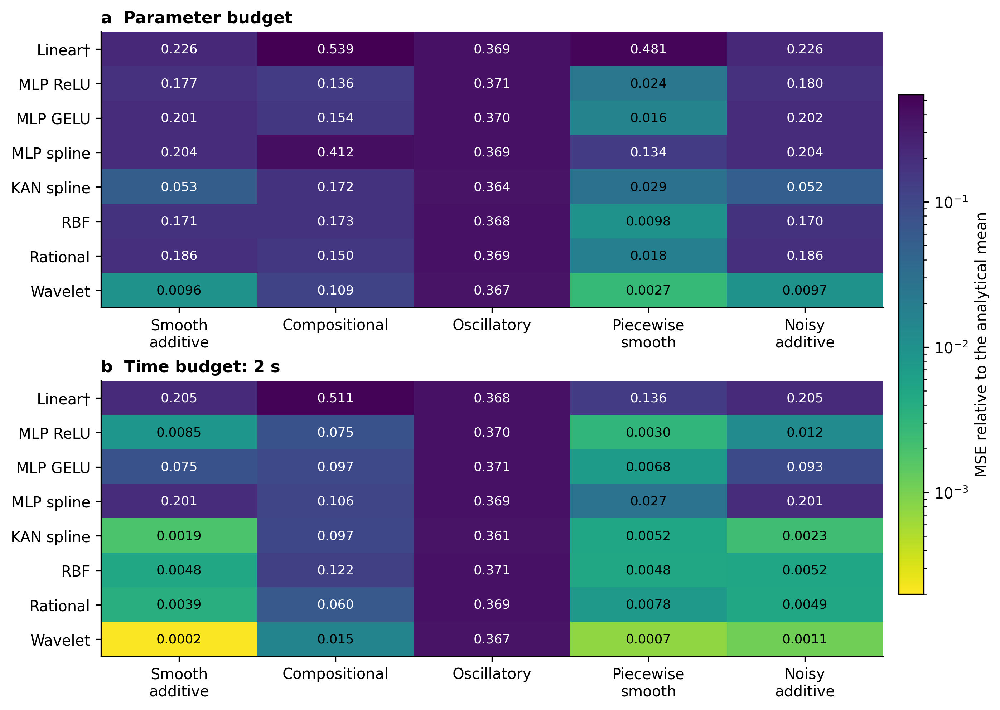
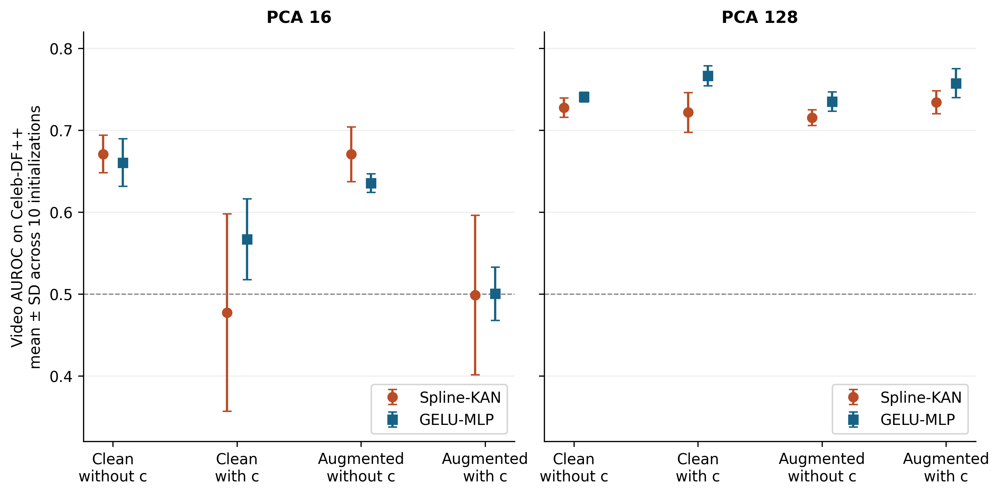
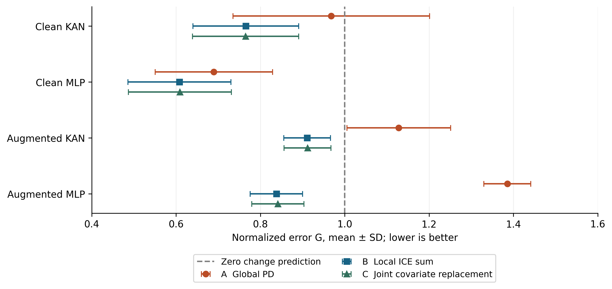

<p align="center">
<h1 align="center"><strong>Forensic Response-Curve Evaluation of Spline-Head Classifiers On Faces</strong></h1>
</p>

## Overview: KAN and MLP heads under forensic interventions

FRESCO compares spline-based Kolmogorov–Arnold network (KAN) heads with MLPs on analytical regression and deepfake detection, and audits whether their explanations track predictions under actual image degradation.

## What was measured

For FaceForensics++ (FF++, c23), 3,600 videos were used for training, 700 for validation, and 840 for testing, including 140 FaceShifter videos held out as an unseen manipulation. The external Celeb-DF++ official test list contained 5,418 videos (178 real, 5,240 fake). The experiment used 32 requested frames per video, face crops, a frozen OpenAI CLIP ViT-L/14 encoder (1,024-dimensional post-layer-normalization, pre-projection CLS), L2 normalization and PCA fitted on source training data. Four image-quality covariates may be added. JPEG, blur and resizing are applied to the face crop; CLIP features and covariates are recomputed. Video scores are means of frame probabilities. Ten random seeds were used in the reported series.

The controlled benchmark has five known functions, eight project-implemented heads and two budgets. Spline, RBF, rational and wavelet variants are implementations inspired by the literature; they are not numerical reproductions of the official FastKAN, KAT or Wav-KAN libraries. Baselines include linear and MLP heads. Parameter matching is approximate, and the linear baseline is not parameter matched. Explanation fidelity is assessed against the model's *actual* prediction change after intervention.

## Selected results

Values below are means ± standard deviations across ten seeds unless noted. They are conditional on the specified dataset, recipe and budget, and should not be generalized to all KANs or tasks.

| Comparison | Spline-KAN | GELU-MLP | Scope |
|---|---:|---:|---|
| FF++ clean video AUROC | 0.8065 ± 0.0018 | 0.8087 ± 0.0031 | Main parameter-budget series |
| Celeb-DF++ clean video AUROC | 0.4795 ± 0.1299 | 0.5767 ± 0.0652 | Same models, external test |
| Celeb-DF++ normalized response gap | 0.7911 ± 0.0842 | 0.6802 ± 0.0807 | Main series; lower is better |
| Smooth additive function MSE | 0.05296 | 0.20143 | Parameter budget, mean over seeds |

For the external AUROC difference KAN − MLP, the crossed seed × cluster 95% interval was [−0.1975, 0.0045]; this is not evidence of a universal performance ordering. For the normalized response-gap difference, the corresponding interval was [0.0236, 0.1903]. The denominators differ by model: absolute response RMSE was 0.5612 for KAN and 0.8048 for MLP, so the gap does not imply that MLP is better under every fidelity metric. A zero-change predictor has normalized gap 1 when the denominator is nonzero.

Spline-KAN response curves had a median pairwise correlation of 0.9893 across the 180 evaluated comparisons between seeds, yet the main normalized response gap was 0.7911, above the prespecified 0.30 threshold. Repeatability alone therefore did not establish sufficient agreement with the model's actual response to image transformations. At batch size 256, mean **head-only** inference latency in the main experiment was 2.2873 ms for spline-KAN versus 0.2341 ms for GELU-MLP, approximately 9.8 times higher on the tested hardware. This excludes face extraction, CLIP, PCA and other pipeline costs. Taken together with the selective function-benchmark advantages, these results do not establish a joint accuracy-and-explanation advantage sufficient to justify the measured extra head cost in this setup.

The follow-up GPU study used source-only expanded PD grids and covered 1,548,349 of 1,559,061 external frame–intervention pairs (99.3129%). Coverage is a property of this evaluation population, not evidence that training improved. In the clean follow-up, the MLP global PD gap was 0.6895 ± 0.1393, and its crossed interval for the difference from the zero-change baseline was [−0.3915, −0.2219]; global PD explanations were therefore useful relative to that baseline in this specific setting. The analogous clean KAN interval included zero. The augmentation and covariate contrasts are exploratory; a local KAN advantage does not imply universal superiority. These follow-up values must not be directly subtracted from the main gap as an isolated training effect because the models and evaluation support differ.

The factorial representation analysis used a separately audited historical cache. That cache is numerically different from the original main-series cache, despite matching recorded provenance in other respects. Its 16- and 128-component cells share the historical cache and must not be merged with the original main baseline. Results of PD/ALE, surrogates and symbolic simplification are exploratory. None of the ten tested KAN copies became fully symbolic.








## Requirements and inputs

The reported detector runs used Ubuntu, an NVIDIA RTX 4090, CUDA-enabled PyTorch 2.6.0 and Python 3.11. The lock file selects CUDA 12.4 wheels. 

## Run from raw videos

Run from the repository root in Bash. Replace the two dataset paths; preserve the original lists and follow the dataset access conditions. The included FF++ splits are the ones used in this package; retain them for comparability.

```bash
export FFPP_ROOT=/absolute/path/to/FaceForensics++_C23
export CELEBDFPP_ROOT=/absolute/path/to/CelebDFpp
test -f "$CELEBDFPP_ROOT/List_of_testing_videos.txt"
uv python install 3.11
uv sync --frozen --extra dev
nvidia-smi
uv run --frozen python -c 'import torch; print(torch.__version__, torch.version.cuda, torch.cuda.get_device_name(0)); assert torch.cuda.is_available()'
make test
make smoke

# Face detector: pin and check the historically used bytes.
mkdir -p data/models
curl --fail --location https://media.githubusercontent.com/media/opencv/opencv_zoo/main/models/face_detection_yunet/face_detection_yunet_2023mar.onnx --output data/models/face_detection_yunet_2023mar.onnx
echo '8f2383e4dd3cfbb4553ea8718107fc0423210dc964f9f4280604804ed2552fa4  data/models/face_detection_yunet_2023mar.onnx' | sha256sum -c -

make prepare-data                                                                                                       # discover videos, enforce splits and create index
make extract-faces                                                                                                      # sample frames, detect/crop faces, write faces.csv
make extract-features                                                                                                   # frozen CLIP and covariates, including test interventions
uv run --frozen python scripts/feature_job.py --validate-only
make run-all ARGS="'stages=[train,report]'"
```

Stop if a validation fails; inspect coverage, dataset/list and encoder hashes before training. The synthetic smoke test checks software integration, not scientific results. `make run-all` runs the five-function benchmark (100 epochs, patience 15, 2-second time budget) and `full_features`, `main`, `k_ablation`, `covariate_ablation` and `lomo`. Results are written to `outputs/<preset>/<content-key>/`. 

## Follow-up GPU controls

After the core run, point the variables to the **new, complete** main and full-features output directories (the compact `evidence/` summaries cannot substitute for them). The response cache and output directory must be new and separate from the original cache. Use the paths printed in the actual `LATEST.json` files.

```bash
export FRESCO_DEVICE=cuda
export FRESCO_DATA_DIR="$PWD/data"
export FRESCO_CACHE="$PWD/data/cache/clip_vitl14"
export FRESCO_MAIN_EXPERIMENT=/absolute/path/to/outputs/main/CONTENT_KEY
export FRESCO_FULL_EXPERIMENT=/absolute/path/to/outputs/full_features/CONTENT_KEY
export FRESCO_RESPONSE_CACHE="$PWD/data/cache/clip_vitl14_response"
export FRESCO_OUTPUT_ROOT="$PWD/outputs/gpu_extension"
bash scripts/run_research_gpu.sh preflight
bash scripts/run_research_gpu.sh audit
bash scripts/run_research_gpu.sh native-audit
bash scripts/run_research_gpu.sh features
bash scripts/run_research_gpu.sh train
bash scripts/run_research_gpu.sh analyze
bash scripts/run_research_gpu.sh support
bash scripts/run_research_gpu.sh representations
```

## Explanation analyses and historical factorial

The response, PD/ALE, surrogate and symbolic commands require complete trained main models, the matching cache, replay provenance and historical curves, not just summary CSV files. Set `FRESCO_MAIN_EXPERIMENT`, `FRESCO_CACHE`, `FRESCO_REPLAY_PROVENANCE`, `FRESCO_CURVES_V2` and `FRESCO_DEVICE`. If replay provenance is missing, generate it with `fresco.explanation_audit` using the documented command. Surrogates also need transformed FF++ source pairs and a separate EBM environment. For example, after the main run and with face crops available:

```bash
uv run --frozen python -m fresco.extensions.source_cache \
  --cache "$FRESCO_CACHE" --faces "$PWD/data/faces/faces.csv" \
  --output "$PWD/outputs/extensions/representation/source_pairs_new/source_pairs" \
  --device cuda --batch-size 4
export FRESCO_SOURCE_CACHE="$PWD/outputs/extensions/representation/source_pairs_new/source_pairs"
uv venv --python 3.11 .venv-ebm
uv pip install --python .venv-ebm/bin/python --constraint configs/extensions/ebm-constraints.txt interpret-core
export FRESCO_EBM_PYTHON="$PWD/.venv-ebm/bin/python"
uv run --frozen python -m fresco.extensions response --validate-only --full-check
uv run --frozen python -m fresco.extensions explanations --analysis surrogates --validate-only --full-check
uv run --frozen python -m fresco.extensions response --run-id response_new
uv run --frozen python -m fresco.extensions explanations --analysis pd_ale --run-id pd_ale_new
uv run --frozen python -m fresco.extensions explanations --analysis surrogates --run-id surrogates_new
uv run --frozen python -m fresco.extensions explanations --analysis symbolic --run-id symbolic_new
```

Run each analysis only after its own `--validate-only --full-check` passes; the corresponding commands are obtained by adding those two flags to each analysis command. Use a fresh run ID when inputs change. EBM constraints are separate from the main lock, so record and check the resolved worker versions. A newly generated source-only cache can support surrogates but **cannot** establish identity with the historical factorial cache.

To reproduce the paper's historical factorial reuse, independently obtain the old combined `clip_vitl14_response` cache (`manifest.json`, `features.npy`, `covariates.npy`, `metadata.csv`), both full historical clean/augmented output trees with all 80 k=16 checkpoints and their provenance, and matching code/runtime. Set `FRESCO_SOURCE_CACHE`, `FRESCO_CLEAN_RUN`, `FRESCO_AUGMENTED_RUN`, and `FRESCO_HISTORICAL_CODE` to those exact paths, in addition to the main inputs, then:

```bash
uv run --frozen python -m fresco.extensions representation --historical-factorial-cache --validate-only --full-check
# Only after VERIFIED_WITH_LIMITATIONS and no issues:
uv run --frozen python -m fresco.extensions representation --historical-factorial-cache --run-id factorial_new
```

This audit reuses 80 verified historical k=16 fits and trains 80 k=128 fits; it is not a bitwise rerun of the original main cache. If those historical inputs are unavailable or fail validation, exact reproduction of the published factorial is **blocked**; a newly trained factorial is a new experiment. 

## Citation

If you find this work useful, please cite:

```bibtex
@misc{vonexel_fresco_df,
  author       = {{Nikolai Mozgovoi}},
  title        = {{FRESCO-DF}},
  howpublished = {\url{https://github.com/vonexel/FRESCO-DF}},
  note         = {GitHub repository}
}
```

If you use the FaceForensics++ dataset, please also cite:

```bibtex
@inproceedings{rossler2019faceforensics,
  title={FaceForensics++: Learning to Detect Manipulated Facial Images},
  author={R{\"o}ssler, Andreas and Cozzolino, Davide and Verdoliva, Luisa and Riess, Christian and Thies, Justus and Niessner, Matthias},
  booktitle={IEEE/CVF International Conference on Computer Vision (ICCV)},
  year={2019}
}
```

If you use the Celeb-DF++ benchmark, please cite:

```bibtex
@article{li2025celeb,
  title={Celeb-DF++: A Large-scale Challenging Video DeepFake Benchmark for Generalizable Forensics},
  author={Li, Yuezun and Zhu, Delong and Cui, Xinjie and Lyu, Siwei},
  journal={arXiv preprint arXiv:2507.18015},
  year={2025}
}

@inproceedings{li2020celeb,
  title={Celeb-DF: A Large-scale Challenging Dataset for Deepfake Forensics},
  author={Li, Yuezun and Yang, Xin and Sun, Pu and Qi, Honggang and Lyu, Siwei},
  booktitle={IEEE Conference on Computer Vision and Pattern Recognition},
  year={2020}
}
```

---

## License

This project is licensed under the MIT License. See [LICENSE](LICENSE) for details.

Note that the FaceForensics++ and Celeb-DF++ datasets are subject to their own licensing terms, which must be observed independently of the code license.